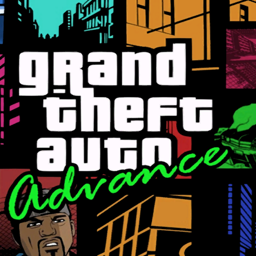
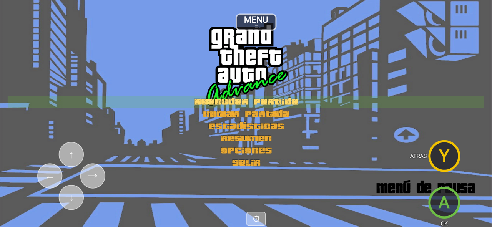

# RE3 GTA Advance Port

Port a Android del mod **GTA Advance PC** (la conversión de *Grand Theft Auto Advance* de GBA a GTA III para PC) sobre [RE3 Android Evolved](https://github.com/codepdbh/re3-android-port-evolved), el mismo motor y los mismos arreglos de Android.

**Solo código fuente: no incluye archivos del juego ni del mod.** Necesitas tu propia copia de GTA III y del mod.

## Estado: arranca y llega al menú

El juego carga el mundo del mod completo (mapas ADVANCE y ULTI, vehículos nuevos, texturas) y llega al menú principal con los textos del mod. Todavía falta probar a fondo las misiones.



## Descarga

La APK está en [Releases](../../releases). Se instala como una app aparte (**GTA Advance**, paquete `com.re3.game.advance`) y convive con el juego base y con los otros ports.

## Cómo preparar los archivos del juego

La app lee los datos de `/sdcard/re3-gtaadvance` (almacenamiento interno).

1. Copia a esa carpeta una instalación completa de GTA III que ya funcione con re3 Android.
2. Copia encima el contenido de la carpeta del mod (`GTA ADVANCE  PC`), reemplazando lo que coincida.
3. Prepara los archivos con los scripts de [`tools/gtaadvance/`](tools/gtaadvance) (Python 3). Hacen lo que en PC hacen los plugins:
   - **Textos:** `build_text.py` genera `TEXT/*.gxt` a partir del GXT del mod (`plugins/wm_lcchs/wm_lcchs.gxt`, en inglés) combinado con los GXT de re3 (`gamefiles/TEXT`). En otros idiomas, el menú queda traducido y la historia del mod sale en inglés.
   - **Texturas de modloader:** `img.py` mete las texturas de `modloader/ADVANCE/models/gta3img/*.txd` dentro de `models/gta3.img`. Copia también `modloader/ADVANCE/models/generic.txd` a `models/`.
4. Borra `models/txd.img`, `models/txd.dir` y `data/CAPS.DAT`. El mod trae versiones vacías pensadas para PC; re3 regenera la caché de texturas en el primer arranque, que por eso tarda más.
5. Borra lo que solo sirve en PC: `.exe`, `.dll`, `.asi`, `CLEO/`, `modloader/`, `plugins/` y `scripts/`.
6. Copia de `gamefiles/` de este repo las carpetas `neo/` y los `models/fonts_*.txd`, `frontend_*.txd` y `*btns.txd`, **sin** pisar los `generic.txd`, `particle.txd` y `menu.txd` del mod.
7. No uses partidas guardadas del GTA III normal: el script del mod es distinto.

## Qué es esto

Un product flavor de Gradle (`advance`) sobre el mismo código de `re3-android-port-evolved`. El código nativo es el mismo para todas las variantes; lo propio del mod se activa solo cuando el juego detecta sus datos (`DATA\MAPS\ADVANCE\ADVANCE.IDE`, bandera `gbModGtaAdvance`), así que la app base no cambia.

### Scripts CLEO del mod, reescritos en el motor

En Android no hay intérprete de CLEO, así que cada script se reimplementó en C++:

- **NewCar Fix:** GTA III conserva código de Vice City que trata los modelos 154, 155 y 159 como RC Baron, RC Raider y Sparrow. El mod usa esos IDs para autos normales (Hellenbach, Panto, Toyz), que acababan volando. En el mod esas comprobaciones se desactivan (`IsMiamiRcBaron()` y compañía en `ModelIndices.h`).
- **d_dodo_fix:** el Dodo usa el modelo de vuelo completo (`FLIGHT_MODEL_SEAPLANE`) en vez del recortado.
- **bscript:** con el botón de salir puedes saltar de un vehículo a más de 15 m/s.
- **cover:** agacharse a pie con un botón (L3, que a pie no hace nada; en la app aparece como **AGACHAR**). Saltar también te levanta.

### Arreglos del motor para el mod

- **Textos:** el buffer de carga de GXT era de 256 KB y los GXT del mod, combinados con los de re3, pesan ~380 KB. Crasheaba al arrancar; ahora es de 1 MB.
- **Texturas (librw):** el `particle.txd` del mod usa formatos D3D 565 y 4444, que librw no sabía convertir y dejaban una imagen nula. Ahora se convierten, y un formato sin soporte ya no tumba el juego. Arreglado en el fork [librw-re3-android](https://github.com/codepdbh/librw-re3-android).
- **Límites:** subí edificios, dummies, nodos, TXD y nodos de ruta en `config.h` para los mapas nuevos. Los valores de rutas eran exactamente los de vanilla, sin margen.
- **Scripts:** un script desincronizado se retira solo, en vez de ejecutar basura y crashear. Varias comprobaciones de handles nulos vienen del port de Forelli Redemption.

### Controles

Traídos de [reVC Android Enhanced](https://github.com/codepdbh/reVC-android-evolved-ENHANCED-MOD):

- **Cambio automático de entrada:** táctil, mando o teclado/ratón. Al usar un mando o un teclado se ocultan los controles táctiles, y vuelven al tocar la pantalla.
- **Ratón:** en el juego mueve la cámara; en los menús mueve el cursor y hace clic.
- **Mando Bluetooth:** se detecta al instante cuando se desconecta.
- **Estilos de botones:** Propio, Xbox o PlayStation. Se cambian desde el engranaje, con el botón **ESTILO**.

## No portado

- **LCSCarCam** (cámara de autos estilo LCS) e **IIILodLights** (luces lejanas): son plugins `.asi` de PC sin equivalente en re3.
- **SilentPatch, WidescreenFix, MenuMap y el control de framerate:** re3 ya los cubre.
- **Idioma:** el mod solo trae textos en inglés.

## Compilar

```
cd android/launcher
gradlew assembleAdvanceRelease
```

Requiere el Android SDK, el NDK 27.2 y los submódulos (`git submodule update --init`).

---

# README original de re3


[](https://actions-badge.atrox.dev/GTAmodding/re3/goto?ref=master)
<a href="https://discord.gg/RFNbjsUMGg"></a>

## Intro

In this repository you'll find the fully reversed source code for GTA III ([master](https://github.com/GTAmodding/re3/tree/master/) branch) and GTA VC ([miami](https://github.com/GTAmodding/re3/tree/miami/) branch).

It has been tested and works on Windows, Linux, MacOS and FreeBSD, on x86, amd64, arm and arm64.\
Rendering is handled either by original RenderWare (D3D8)
or the reimplementation [librw](https://github.com/aap/librw) (D3D9, OpenGL 2.1 or above, OpenGL ES 2.0 or above).\
Audio is done with MSS (using dlls from original GTA) or OpenAL.

The project has also been ported to the [Nintendo Switch](https://github.com/AGraber/re3-nx/),
[Playstation Vita](https://github.com/Rinnegatamante/re3) and
[Nintendo Wii U](https://github.com/GaryOderNichts/re3-wiiu/).

We cannot build for PS2 or Xbox yet. If you're interested in doing so, get in touch with us.

## Installation

- re3 requires PC game assets to work, so you **must** own [a copy of GTA III](https://store.steampowered.com/app/12100/Grand_Theft_Auto_III/).
- Build re3 or download the latest build:
  - [Windows D3D9 MSS 32bit](https://nightly.link/GTAmodding/re3/workflows/re3_msvc_x86/master/re3_Release_win-x86-librw_d3d9-mss.zip)
  - [Windows D3D9 64bit](https://nightly.link/GTAmodding/re3/workflows/re3_msvc_amd64/master/re3_Release_win-amd64-librw_d3d9-oal.zip)
  - [Windows OpenGL 64bit](https://nightly.link/GTAmodding/re3/workflows/re3_msvc_amd64/master/re3_Release_win-amd64-librw_gl3_glfw-oal.zip)
  - [Linux 64bit](https://nightly.link/GTAmodding/re3/workflows/build-cmake-conan/master/ubuntu-18.04-gl3.zip)
  - [MacOS 64bit x86-64](https://nightly.link/GTAmodding/re3/workflows/build-cmake-conan/master/macos-latest-gl3.zip)
- Extract the downloaded zip over your GTA 3 directory and run re3. The zip includes the binary, updated and additional gamefiles and in case of OpenAL the required dlls.

## Screenshots


## Improvements

We have implemented a number of changes and improvements to the original game.
They can be configured in `core/config.h`.
Some of them can be toggled at runtime, some cannot.

* Fixed a lot of smaller and bigger bugs
* User files (saves and settings) stored in GTA root directory
* Settings stored in re3.ini file instead of gta3.set
* Debug menu to do and change various things (Ctrl-M to open)
* Debug camera (Ctrl-B to toggle)
* Rotatable camera
* XInput controller support (Windows)
* No loading screens between islands ("map memory usage" in menu)
* Skinned ped support (models from Xbox or Mobile)
* Rendering
  * Widescreen support (properly scaled HUD, Menu and FOV)
  * PS2 MatFX (vehicle reflections)
  * PS2 alpha test (better rendering of transparency)
  * PS2 particles
  * Xbox vehicle rendering
  * Xbox world lightmap rendering (needs Xbox map)
  * Xbox ped rim light
  * Xbox screen rain droplets
  * More customizable colourfilter
* Menu
  * Map
  * More options
  * Controller configuration menu
  * ...
* Can load DFFs and TXDs from other platforms, possibly with a performance penalty
* ...

## To-Do

The following things would be nice to have/do:

* Fix physics for high FPS
* Improve performance on lower end devices, especially the OpenGL layer on the Raspberry Pi (if you have experience with this, please get in touch)
* Compare code with PS2 code (tedious, no good decompiler)
* [PS2 port](https://github.com/GTAmodding/re3/wiki/PS2-port)
* Xbox port (not quite as important)
* reverse remaining unused/debug functions
* compare CodeWarrior build with original binary for more accurate code (very tedious)

## Modding

Asset modifications (models, texture, handling, script, ...) should work the same way as with original GTA for the most part.

CLEO scripts work with [CLEO Redux](https://github.com/cleolibrary/CLEO-Redux).

Mods that make changes to the code (dll/asi, limit adjusters) will *not* work.
Some things these mods do are already implemented in re3 (much of SkyGFX, GInput, SilentPatch, Widescreen fix),
others can easily be achieved (increasing limis, see `config.h`),
others will simply have to be rewritten and integrated into the code directly.
Sorry for the inconvenience.

## Building from Source  

When using premake, you may want to point GTA_III_RE_DIR environment variable to GTA3 root folder if you want the executable to be moved there via post-build script.

Clone the repository with `git clone --recursive https://github.com/GTAmodding/re3.git`. Then `cd re3` into the cloned repository.

<details><summary>Linux Premake</summary>

For Linux using premake, proceed: [Building on Linux](https://github.com/GTAmodding/re3/wiki/Building-on-Linux)

</details>

<details><summary>Linux Conan</summary>

Install python and conan, and then run build.
```
conan export vendor/librw librw/master@
mkdir build
cd build
conan install .. re3/master@ -if build -o re3:audio=openal -o librw:platform=gl3 -o librw:gl3_gfxlib=glfw --build missing -s re3:build_type=RelWithDebInfo -s librw:build_type=RelWithDebInfo
conan build .. -if build -bf build -pf package
```
</details>

<details><summary>MacOS Premake</summary>

For MacOS using premake, proceed: [Building on MacOS](https://github.com/GTAmodding/re3/wiki/Building-on-MacOS)

</details>

<details><summary>FreeBSD</summary>

For FreeBSD using premake, proceed: [Building on FreeBSD](https://github.com/GTAmodding/re3/wiki/Building-on-FreeBSD)

</details>

<details><summary>Windows</summary>

Assuming you have Visual Studio 2015/2017/2019:
- Run one of the `premake-vsXXXX.cmd` variants on root folder.
- Open build/re3.sln with Visual Studio and compile the solution.

Microsoft recently discontinued its downloads of the DX9 SDK. You can download an archived version here: https://archive.org/details/dxsdk_jun10

**If you choose OpenAL on Windows** You must read [Running OpenAL build on Windows](https://github.com/GTAmodding/re3/wiki/Running-OpenAL-build-on-Windows).
</details>

> :information_source: premake has an `--with-lto` option if you want the project to be compiled with Link Time Optimization.

> :information_source: There are various settings in [config.h](https://github.com/GTAmodding/re3/tree/master/src/core/config.h), you may want to take a look there.

> :information_source: re3 uses completely homebrew RenderWare-replacement rendering engine; [librw](https://github.com/aap/librw/). librw comes as submodule of re3, but you also can use LIBRW enviorenment variable to specify path to your own librw.

If you feel the need, you can also use CodeWarrior 7 to compile re3 using the supplied codewarrior/re3.mcp project - this requires the original RW33 libraries, and the DX8 SDK. The build is unstable compared to the MSVC builds though, and is mostly meant to serve as a reference.

## Contributing
As long as it's not linux/cross-platform skeleton/compatibility layer, all of the code on the repo that's not behind a preprocessor condition(like FIX_BUGS) are **completely** reversed code from original binaries.  

We **don't** accept custom codes, as long as it's not wrapped via preprocessor conditions, or it's linux/cross-platform skeleton/compatibility layer.

We accept only these kinds of PRs;

- A new feature that exists in at least one of the GTAs (if it wasn't in III/VC then it doesn't have to be decompilation)  
- Game, UI or UX bug fixes (if it's a fix to original code, it should be behind FIX_BUGS)
- Platform-specific and/or unused code that's not been reversed yet
- Makes reversed code more understandable/accurate, as in "which code would produce this assembly".
- A new cross-platform skeleton/compatibility layer, or improvements to them
- Translation fixes, for languages original game supported
- Code that increase maintainability  

We have a [Coding Style](https://github.com/GTAmodding/re3/blob/master/CODING_STYLE.md) document that isn't followed or enforced very well.

Do not use features from C++11 or later.


## History

re3 was started sometime in the spring of 2018,
initially as a way to test reversed collision and physics code
inside the game.
This was done by replacing single functions of the game
with their reversed counterparts using a dll.

After a bit of work the project lay dormant for about a year
and was picked up again and pushed to github in May 2019.
At the time I (aap) had reversed around 10k lines of code and estimated
the final game to have around 200-250k.
Others quickly joined the effort (Fire_Head, shfil, erorcun and Nick007J
in time order, and Serge a bit later) and we made very quick progress
throughout the summer of 2019
after which the pace slowed down a bit.

Due to everyone staying home during the start of the Corona pandemic
everybody had a lot of time to work on re3 again and
we finally got a standalone exe in April 2020 (around 180k lines by then).

After the initial excitement and fixing and polishing the code further,
reVC was started in early May 2020 by starting from re3 code,
not by starting from scratch replacing functions with a dll.
After a few months of mostly steady progress we considered reVC
finished in December.

Since then we have started reLCS, which is currently work in progress.


## License

We don't feel like we're in a position to give this code a license.\
The code should only be used for educational, documentation and modding purposes.\
We do not encourage piracy or commercial use.\
Please keep derivate work open source and give proper credit.
